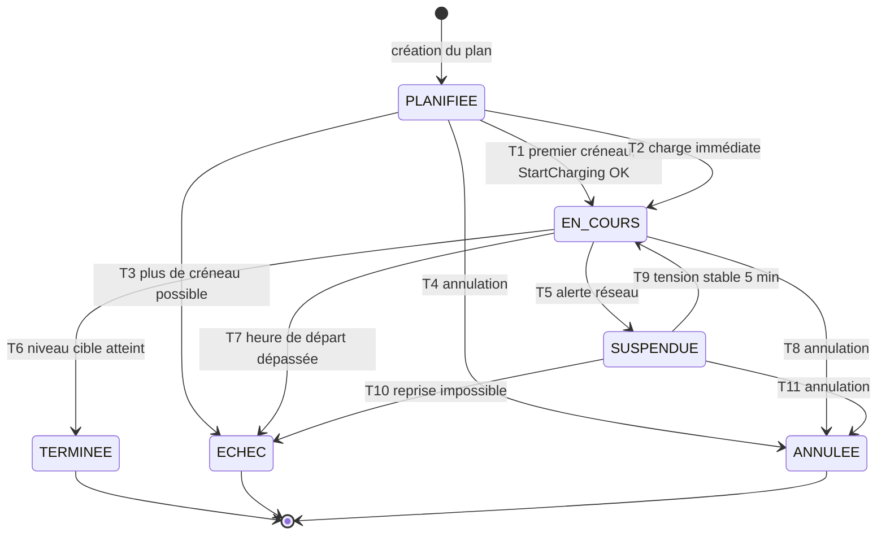

# Machine à états d'une session de charge

## 1. États
| État | Signification | Final ? |
|---|---|---|
| PLANIFIEE | Plan créé, charge pas encore commencée | non |
| EN_COURS | La borne charge (éventuellement à puissance réduite) | non |
| SUSPENDUE | Charge arrêtée à cause du réseau, reprise possible | non |
| TERMINEE | Niveau cible atteint | oui |
| ECHEC | Cible inatteignable avant le départ ; niveau atteint communiqué | oui |
| ANNULEE | Plan annulé par l'utilisateur (Reco, hors PDF) | oui |

## 2. Diagramme

## 3. Transitions
| N° | De | Vers | Événement | Garde | Action | Notification |
|---|---|---|---|---|---|---|
| T1 | PLANIFIEE | EN_COURS | Début du premier créneau | G1 : zone stable ; StartCharging réussi | Appel gRPC StartCharging | « Charge démarrée » |
| T2 | PLANIFIEE | EN_COURS | Clic « Charge immédiate » | G1 ; biométrie validée si activée | Appel gRPC StartCharging, replanification | « Charge immédiate lancée » |
| T3 | PLANIFIEE | ECHEC | Créneau expiré, démarrage impossible | Aucun créneau restant avant le départ | Enregistrer l'échec | « Charge impossible : réseau instable » |
| T4 | PLANIFIEE | ANNULEE | DELETE du plan | aucune | Libérer les créneaux | aucune |
| T5 | EN_COURS | SUSPENDUE | Alerte réseau (coupure, surtension, sous-tension persistante, micro-coupures) | aucune | StopCharging (deadline 2 s), incident enregistré | Message selon l'alerte |
| T6 | EN_COURS | TERMINEE | Mesure : niveau >= cible | aucune | StopCharging, calcul de l'économie | « Charge terminée à hh:mm, batterie à X % » |
| T7 | EN_COURS | ECHEC | Heure de départ atteinte | niveau < cible | StopCharging | « Départ : batterie à X % » |
| T8 | EN_COURS | ANNULEE | DELETE du plan | aucune | StopCharging | aucune |
| T9 | SUSPENDUE | EN_COURS | Retour du courant | G2 : tension dans 207-253 V sans interruption pendant 5 min | StartCharging par paliers 25/50/75/100 %, replanification | « Charge reprise » |
| T10 | SUSPENDUE | ECHEC | Heure de départ proche | G6 : temps restant insuffisant pour atteindre le niveau minimal | Enregistrer le niveau atteint | « Reprise impossible, batterie à X % » |
| T11 | SUSPENDUE | ANNULEE | DELETE du plan | aucune | aucune | aucune |

Toute autre transition (par exemple TERMINEE vers EN_COURS, ou SUSPENDUE vers TERMINEE)
est interdite : le service lève une exception métier traduite en réponse 409.

## 4. Gardes
- G1 : indice de stabilité de la zone au-dessus du seuil et aucune alerte active.
- G2 : tension entre 207 V et 253 V en continu pendant 5 minutes.
- G6 : à l'instant t, énergie restante / puissance de la borne > temps restant jusqu'au départ.

## 5. Réaction du système aux six événements réseau
| Événement | Seuil | Réaction | Transition | Message |
|---|---|---|---|---|
| Sous-tension | < 207 V pendant plus de 10 s | Puissance à 50 %. Si l'anomalie dure encore 60 s : suspension | EN_COURS (limitée) puis T5 | « Tension basse, puissance réduite » |
| Surtension | > 253 V | Arrêt immédiat | T5 | « Surtension, charge arrêtée » |
| Coupure totale | tension absente 5 s ou plus | Suspension | T5 | « Coupure détectée, charge suspendue » |
| Micro-coupures | plus de 3 en 10 min | Arrêt préventif | T5 | « Réseau instable, charge en pause » |
| Retour du courant | tension revenue | Attente 5 min puis paliers | T9 | « Courant revenu, reprise dans 5 min » |
| Coupure programmée | annoncée par SOAP | Replanification avant la coupure, pas de changement d'état | aucune | « Coupure prévue à 2h, charge avancée » |

## 6. Scénario de référence (exemple d'Ines)
1. 19h : plan créé, départ 7h, cible 90 %. État PLANIFIEE. Créneau retenu 23h-5h.
2. 23h : T1, EN_COURS.
3. 1h30 : coupure. grid-quality émet une alerte, le scheduler fait T5 (SUSPENDUE), notifie.
4. 2h10 : courant revenu, message « reprise dans 5 min ».
5. 2h15 : G2 vraie, T9, EN_COURS par paliers, nouveau créneau jusqu'à 5h45.
6. 5h45 : T6, TERMINEE, batterie à 90 %.